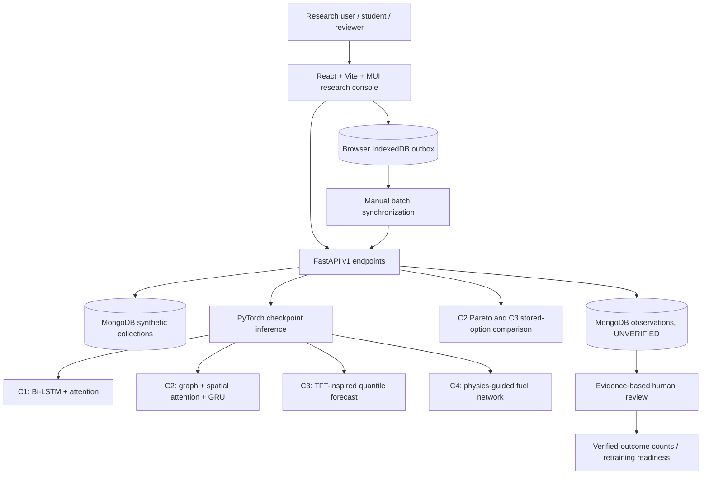
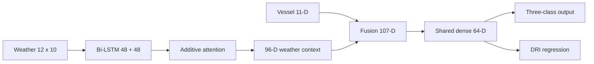
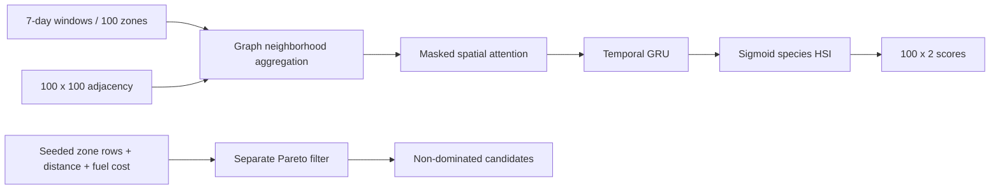
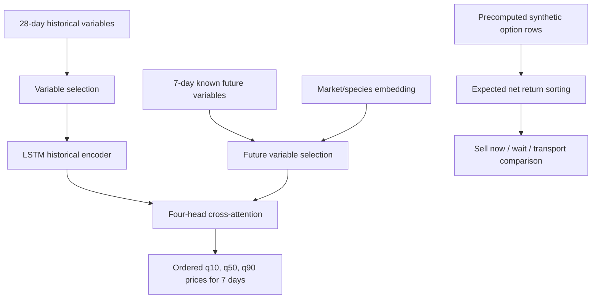
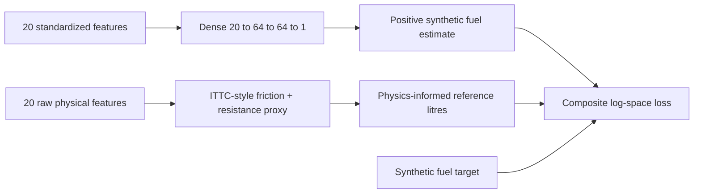
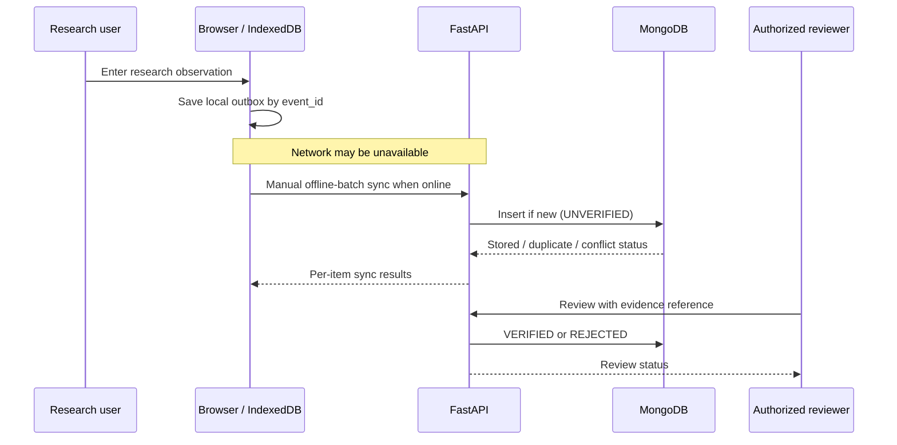

# OceanGuard AI

### AI-Driven Offline-First Safety and Rescue System for Artisanal Fishing Vessels

**Integrated University Research Project — Complete Technical README**

> **Repository scope:** This README documents the supplied **`OceanGuardAI_React_MongoDB_4ML_Fullstack_v1.zip`** research prototype, including all four machine-learning components, its React frontend, FastAPI backend, MongoDB research data layer, saved PyTorch checkpoints, and offline observation-queue workflow. It should be placed in the root of the unzipped `FishingAI_React_MongoDB_ML_v1/` project directory. The four component-specific READMEs provide additional individual technical details.
>
> **Research-use disclosure:** The training datasets, trained checkpoint evaluations, fishing-zone comparisons, market scenarios and fuel outcomes in this prototype are **synthetic or physics-simulated**. This system has **not** been validated for safety-critical navigation, actual catch probability, fish food-safety certification, emergency dispatch or measured-fuel planning. It does not send SOS alerts to rescue services.

---

## 1. Project information

| Item | Details |
|---|---|
| Project title | AI-Driven Offline-First Safety and Rescue System for Artisanal Fishing Vessels |
| Project name | **OceanGuard AI** |
| Project ID | **J26-IT-440** |
| Research area | Artificial Intelligence, Machine Learning, Marine Decision Support, Offline-First Applications |
| Project type | Four-member integrated university research project |
| Development phase | Research prototype / PP1 implementation snapshot |
| Primary technologies | React 19, Vite 6, Material UI 7, FastAPI, MongoDB, PyTorch, NumPy, scikit-learn |
| Data provenance | Four synthetic master datasets of 5,000 records each; additional auxiliary and model-ready arrays |
| Documentation snapshot | 30 October 2026 |

### Research team and component ownership

| Component | Member (as recorded in supplied component documents) | Student ID | Individual research responsibility |
|---|---|---|---|
| **C1** | H M I L Jayawardana | `IT23207486` | Dynamic vessel-specific safety risk estimation |
| **C2** | Kanchana K P V | `IT23151956` | Spatio-temporal fishing habitat suitability and Pareto comparison |
| **C3** | Wimalasooriya A G P K | `IT23228412` | Fish price forecasting and quality-aware economic scenarios |
| **C4** | Wijendra W A N K | `IT23324510` | Physics-guided voyage fuel estimation |

*Before submission, confirm the student-to-component mapping against the official allocation sheet and update it if necessary.*

---

## 2. Abstract

Sri Lankan artisanal and multi-day fishing operations involve several interdependent decisions. Crews must interpret changing marine conditions for different vessel types, identify environmentally suitable fishing zones, consider fuel requirements, and compare the commercial value of fish catches under different storage and market scenarios. These are often examined separately even though they affect the same voyage.

OceanGuard AI investigates a unified decision-support interface powered by **four independently trained research models**:

1. **C1 — Safety:** a Bidirectional LSTM with additive attention jointly estimates a synthetic vessel risk category and a Dynamic Risk Index (DRI).
2. **C2 — Fishing habitat:** a spatio-temporal graph learning model estimates species-specific Habitat Suitability Index (HSI) values, while a separate Pareto decision algorithm compares synthetic zone attributes.
3. **C3 — Market intelligence:** a lightweight TFT-inspired quantile forecaster estimates future fish prices; a separate synthetic scenario engine ranks sell/wait/transport alternatives by expected net return.
4. **C4 — Fuel:** a physics-guided feed-forward network uses resistance-inspired physical regularization to estimate simulated voyage fuel consumption.

The implementation provides a React research console, modular FastAPI routes, MongoDB collections for synthetic data and separately staged observations, example inference using saved `.pt` checkpoints, a browser IndexedDB outbox for intermittent connectivity, manual review of submitted observations, and a retraining-readiness display. The present version demonstrates **prototype integration and research algorithms**, not an operational maritime or emergency-rescue system.

---

## 3. Research problem and objectives

### 3.1 Overall problem

Existing information sources can leave vessel operators navigating disconnected decisions: regional weather warnings may not reflect vessel loading; ocean conditions alone do not indicate a practical fishing destination; predicted fish prices ignore costs and deterioration; and generic fuel rules may fail to reflect vessel and sea-state differences.

### 3.2 Overall research objective

**To design and evaluate an integrated, offline-aware prototype combining four distinct AI-assisted research functions for artisanal fishing-vessel decision support.**

### 3.3 Specific objectives

- Examine temporal marine conditions alongside vessel features to model vessel-specific proxy risk.
- Learn how marine variables vary over space and time to estimate relative habitat suitability for selected fish species.
- Investigate multi-horizon price forecasts and expected economic options, incorporating fish-quality hypotheses.
- Evaluate simplified hydrodynamic knowledge as a regularizer for a neural fuel estimator.
- Integrate separate models in a comprehensible application, support sample demonstration, and document scientific limitations.
- Stage observations locally during an interrupted connection and submit them for review when connectivity returns.

### 3.4 Intended stakeholders

Fishing-vessel operators, vessel owners, fisher cooperatives, harbour stakeholders, marine researchers, and university evaluators are potential users or beneficiaries. They have **not** been established as paying customers or verified operational adopters in this implementation.

---

## 4. Overall system architecture



### 4.1 Technology choices

| Layer | Actual technology | Responsibility |
|---|---|---|
| Frontend | React 19, Vite 6, React Router 7, MUI 7 | Research dashboard, component pages, forms, navigation |
| Charts | Recharts 3 | Attention and forecasting visuals |
| Offline observation staging | IndexedDB, service worker | Local outbox and supporting offline UI assets; not offline live ML inference |
| API | Python FastAPI, Pydantic | Research endpoints, validation, dataset retrieval and prediction responses |
| Data storage | MongoDB / PyMongo | Seeded synthetic data, scenario options, observations and review status |
| Machine learning | PyTorch | Four separately defined neural models and saved checkpoints |
| Numerical processing | NumPy, scikit-learn | Model-ready arrays, evaluation and supporting numerical operations |
| Development testing | Pytest | Model-output and decision-logic tests |
| Optional local infrastructure | Docker Compose with MongoDB 7 | Repeatable local database startup |

### 4.2 End-to-end research workflow

1. The frontend requests available model metadata from `GET /api/v1/models`.
2. A user selects a component and sample index in the research console.
3. The browser calls `POST /api/v1/models/{component}/demo-predict`.
4. FastAPI loads the matching saved checkpoint and a **prebuilt model-ready synthetic sample**.
5. The component-specific PyTorch model returns a research prediction and provenance information.
6. React renders the prediction and relevant charts or structured output.
7. Independent scenario routes query MongoDB and run the C2 Pareto or C3 economic ranking algorithms.

**Integration boundary:** These are coordinated research screens and APIs, not an already verified automatic sequence in which one component's live prediction feeds every other component. The available C1/C4 synthetic identifiers are linked; C2 spatial relations are not time-matched to all voyages; C3 market histories are independent.

---

## 5. Four individual research components

### 5.1 Overview

| Component | Core technical approach | Main model output | Other logic |
|---|---|---|---|
| **C1** — Safety | Bi-LSTM + additive attention + fused vessel features | Safe/Caution/Danger proxy class; DRI | Display attention weights and research risk explanation |
| **C2** — Fishing | Normalized zone graph, spatial attention, temporal GRU | Yellowfin/Skipjack HSI per zone | Separate Pareto non-dominated filtering on seeded scenarios |
| **C3** — Market | TFT-inspired variable selection + LSTM + attention + quantile head | 7-day price q10/q50/q90 | Separate ranking of precomputed sell/wait/transport net-return scenarios |
| **C4** — Fuel | Dense neural net with differentiable physical regularization | Synthetic fuel litres | ITTC-style friction and simplified hydrodynamic proxy in training |

### 5.2 C1 — Dynamic Vessel-Specific Safety Risk Assessment

**Sub-problem:** A broad weather warning does not represent identical vulnerability for differently sized or loaded fishing vessels.

**Input representation:**

- Synthetic forecast weather sequences: `12` time steps × `10` variables per trip.
- Static vessel variables: `11` features per trip.
- Model-ready array: `data/model_ready/C1_BiLSTM_Model_Ready_5000.npz`.

**Architecture:**



The encoded temporal sequence is weighted by attention; its context vector is fused with static vessel features. Two outputs estimate (1) a three-class proxy risk label and (2) a normalized DRI converted to a 0–100 score. The attention weights indicate model emphasis, not demonstrated causality.

**Training objective:**

`L_C1 = WeightedCrossEntropy(risk_class) + 0.15 × MSE(normalized_DRI)`

**Code:** `backend/app/ml/c1_safety/model.py` and shared `backend/app/ml/train.py`.

**Saved research evaluation:** 92.53% synthetic test accuracy, 0.8147 macro-F1, 0.8824 synthetic Danger-class recall. These reflect the checked-in C1 checkpoint, not real maritime incident prediction.

### 5.3 C2 — Spatio-Temporal Fishing Habitat Suitability

**Sub-problem:** Environmental suitability must be interpreted across connected ocean areas and successive days; high suitability alone does not imply a worthwhile or safe destination.

**Model-ready input:** `43` temporal windows × `7` days × `100` zones × `5` environmental features. A normalized `100 × 100` adjacency matrix defines the spatial graph.

**Environmental variables:** sea-surface temperature, chlorophyll-a, current-u, current-v, and SST-front gradient.



**Critical architectural distinction:** The model uses a GRU for temporal encoding. The Pareto API currently reads **seeded HSI values and distance/fuel scenario columns** from MongoDB; it does not dynamically combine freshly inferred network outputs into that endpoint.

**Training objective:** `MSE(predicted_species_HSI, synthetic_species_HSI)`.

**Pareto objectives in the current algorithm:** maximize HSI; minimize scenario distance; minimize scenario fuel cost. A candidate is non-dominated when no other candidate is at least as good on all three objectives and strictly better on one.

**Saved evaluation:** synthetic test HSI MAE `0.17281` and best validation MSE `0.03086`. HSI must not be presented as observed fish-catch probability.

### 5.4 C3 — Fish Price Forecasting and Quality-Aware Decisions

**Sub-problem:** A higher quoted future price does not necessarily produce better net revenue after time, quality loss and logistics costs are considered.

**Price model input:** 28 historical days × 3 variables, 7 future known days × 5 variables, and an embedding for each of the 25 market/species groups.



The model is accurately described as a **lightweight TFT-inspired prototype**, not a complete reference implementation of the canonical TFT architecture. The forecast and the economic decision route are separately implemented pathways.

**Forecast training:** quantile (pinball) loss for quantiles 0.10, 0.50 and 0.90. Ordered predictions yield seven days of uncertainty-oriented price ranges. The saved checkpoint has median-price test MAE **73.35 LKR/kg** and best validation pinball loss **30.61634**, both on synthetic data.

**Biological rationale (research specification):**

`k(T) = k0 × Q10^((T - T_ref)/10)` and `Q(t) = exp(-k(T) × t)`.

The associated earlier research specification uses illustrative assumptions `Q10 = 2.2`, `k0 = 0.015 h⁻¹`, `T_ref = 0°C`. This is a **modeling hypothesis**, not a validated fish-food-safety measure. The supplied runnable project ranks **already computed synthetic commercial-option rows** and does **not** implement a live Q10 freshness recalculation endpoint for arbitrary new inputs.

**Scenario ranking:** `argmax(expected_net_return_lkr)` among available precomputed Sell Now / Wait / Transport options; this is not a real-time trading recommendation.

### 5.5 C4 — Physics-Guided Voyage Fuel Estimation

**Sub-problem:** Measured consumption data for small fishing vessels is scarce, while fuel needs depend on hull, engine, motion and marine conditions.

**Model input:** 20 raw and standardized vessel/engine/environment/voyage features. Training targets are simulated fuel litres, not observed flow-meter readings.



**Hydrodynamic rationale:**

`Re = V × L / ν`  
`C_F = 0.075 / (log10(Re) − 2)²`  
`R_f ≈ 0.5 × ρ × S × V² × C_F`

These are used as part of a simplified differentiable resistance-to-fuel proxy under assumptions about engine efficiency, speed and fuel-specific consumption.

**Implemented objective:**

`L_C4 = SmoothL1(log1p(predicted), log1p(synthetic_target)) + 0.02 × SmoothL1(log1p(predicted), log1p(physics_proxy))`

The architecture is **physics-guided / PINN-inspired**, not a calibrated ship hydrodynamics simulation or a measured-fuel instrument.

**Saved evaluation:** synthetic test fuel MAE **70.93 L**; best validation objective **0.09378**. The provided master fuel dataset has no measured-fuel ground-truth values.

---

## 6. Dataset inventory and provenance

### 6.1 Master synthetic datasets

| Component | File | Rows | Research context |
|---|---|---:|---|
| C1 | `data/synthetic/c1_trips.csv` | 5,000 | Synthetic vessel and marine-weather risk scenarios |
| C2 | `data/synthetic/c2_zone_days.csv` | 5,000 | 100 zones × 50 simulated days |
| C3 | `data/synthetic/c3_market_prices.csv` | 5,000 | 200 dates × 5 markets × 5 species |
| C4 | `data/synthetic/c4_fuel_scenarios.csv` | 5,000 | Simulated hull/sea/voyage and fuel scenarios |
| **Total** | **Four master tables** | **20,000** | **Synthetic research records, not 20,000 measured observations** |

### 6.2 Auxiliary datasets and model-ready tensors

| File | Purpose |
|---|---|
| `data/aux/C1_BiLSTM_Weather_60000_Steps.csv` | 12 synthetic weather steps for each of 5,000 vessel trips |
| `data/aux/C2_Zone_Registry_100.csv` | Maritime zone reference fields |
| `data/aux/C2_Graph_Edges_360.csv` | Graph-edge reference table |
| `data/aux/C3_Option_Economics_5000.csv` | Precomputed synthetic fish-lot economic alternatives |
| `data/aux/C4_Physics_Legs_10000.csv` | Synthetic voyage-leg physics scenarios |
| `data/model_ready/C1_BiLSTM_Model_Ready_5000.npz` | C1 train/validation/test tensors |
| `data/model_ready/C2_STGCN_Model_Ready_43_Windows.npz` | C2 seven-day graph windows |
| `data/model_ready/C3_TFT_{train,validation,test}_28to7.npz` | C3 28-to-7 forecasting windows |
| `data/model_ready/C4_PINN_Model_Ready_5000.npz` | C4 raw/standardized feature tensors and splits |

**Provenance and interpretation:**

- All four original master datasets were synthesized or generated from assumed physical/economic processes.
- C1's risk labels and DRI are synthetic proxy targets, not incident classifications collected at sea.
- C2's habitat indices and geography are research scenarios, not verified fishing grounds or maritime routes.
- C3's prices and commercial alternatives are modeled research values, not authenticated auction data.
- C4's fuel target is physics/simulation derived; `measured_fuel_l` is missing across the provided 5,000 rows.
- Raw observations submitted via the application are stored separately and begin with `UNVERIFIED` status.

---

## 7. Repository structure and source-file responsibilities

```text
FishingAI_React_MongoDB_ML_v1/
├── README.md                            # This consolidated project guide
├── README_SINHALA.md                    # Existing Sinhala research setup guide
├── docker-compose.yml                   # Local MongoDB container
├── .gitignore
├── artifacts/
│   └── models/
│       ├── c1_research.pt
│       ├── c2_research.pt
│       ├── c3_research.pt
│       └── c4_research.pt
├── backend/
│   ├── .env.example
│   ├── requirements.txt
│   ├── requirements-ml.txt
│   ├── requirements-dev.txt
│   ├── scripts/seed_mongodb.py
│   ├── tests/
│   │   ├── test_research_logic.py
│   │   └── test_decision_algorithms.py
│   └── app/
│       ├── main.py
│       ├── core/{constants.py,security.py,settings.py}
│       ├── db/mongo.py
│       ├── routes/{datasets.py,models.py,decisions.py,observations.py}
│       ├── schemas/observations.py
│       ├── services/data_utils.py
│       └── ml/
│           ├── train.py
│           ├── inference.py
│           ├── common/utils.py
│           ├── c1_safety/model.py
│           ├── c2_fishing/{model.py,optimization.py}
│           ├── c3_market/{model.py,decision.py}
│           └── c4_fuel/model.py
├── frontend/
│   ├── .env.example
│   ├── package.json
│   ├── vite.config.js
│   ├── public/{manifest.webmanifest,sw.js}
│   └── src/
│       ├── main.jsx
│       ├── api/client.js
│       ├── theme.js
│       ├── style.css
│       ├── components/{Common.jsx,Layout.jsx}
│       ├── lib/offlineQueue.js
│       └── pages/
│           ├── Overview.jsx
│           ├── ComponentPage.jsx
│           ├── Datasets.jsx
│           ├── Models.jsx
│           ├── Observations.jsx
│           └── Governance.jsx
├── data/
│   ├── synthetic/
│   ├── aux/
│   └── model_ready/
└── docs/
    ├── ARCHITECTURE_SINHALA.md
    ├── QA_AND_LIMITATIONS.md
    └── MANIFEST.json
```

### Key backend responsibilities

| Module | Function |
|---|---|
| `backend/app/main.py` | FastAPI creation, startup database checks, route registration, health and integration status |
| `backend/app/core/constants.py` | Dataset-to-collection mapping and permitted observation types |
| `backend/app/core/security.py` | Development ingest/review API-key checks |
| `backend/app/db/mongo.py` | MongoDB client lifecycle and collection access |
| `backend/app/routes/datasets.py` | Overview, paginated synthetic datasets and field metadata |
| `backend/app/routes/models.py` | Model registry, prebuilt synthetic demo inference and disabled live inference |
| `backend/app/routes/decisions.py` | C2 Pareto filtering and C3 stored-option ranking |
| `backend/app/routes/observations.py` | Observation ingest, offline-batch sync, manual review and verified-outcome counts |
| `backend/app/ml/train.py` | Reproducible four-model synthetic training |
| `backend/app/ml/inference.py` | Model-ready example inference from saved `.pt` checkpoints |
| `backend/scripts/seed_mongodb.py` | Populate/reconcile synthetic research collections |

### Key frontend responsibilities

| Module | Function |
|---|---|
| `frontend/src/main.jsx` | Router and application bootstrap |
| `frontend/src/components/Layout.jsx` | Shared navigation and page layout |
| `frontend/src/pages/Overview.jsx` | Integrated project and dataset overview |
| `frontend/src/pages/ComponentPage.jsx` | Individual C1–C4 demos, result displays and charts |
| `frontend/src/pages/Datasets.jsx` | Paginated synthetic data explorer |
| `frontend/src/pages/Models.jsx` | Model checkpoint registry and experiment metadata |
| `frontend/src/pages/Observations.jsx` | Observation entry, offline queue and submission |
| `frontend/src/pages/Governance.jsx` | Observation review, scientific boundaries and retraining readiness |
| `frontend/src/lib/offlineQueue.js` | IndexedDB outbox operations |
| `frontend/src/api/client.js` | Frontend-to-API request wrapper |

---

## 8. Installation and local execution (Windows PowerShell)

### 8.1 Prerequisites

- Python **3.11+** (prototype documentation reports Python 3.13 used during development).
- Node.js **20.19+** or **22+** and npm.
- MongoDB Server, MongoDB Atlas **or** Docker Desktop with Compose.
- Sufficient local memory/storage for PyTorch and the provided datasets.

Unzip `OceanGuardAI_React_MongoDB_4ML_Fullstack_v1.zip` and open a terminal in `FishingAI_React_MongoDB_ML_v1/`. The root commands assume this directory.

### 8.2 Start MongoDB

```powershell
docker compose up -d mongodb
```

Alternatively, use a locally running MongoDB server or set an appropriate connection URI for MongoDB Atlas. The included Compose file binds port 27017 to localhost.

### 8.3 Prepare backend

```powershell
cd backend
py -m venv .venv
.\.venv\Scripts\Activate.ps1
python -m pip install --upgrade pip
python -m pip install -r requirements-dev.txt
Copy-Item .env.example .env
```

Edit `backend/.env` to define your real local MongoDB connection and **unique, distinct** `INGEST_API_KEY` and `REVIEW_API_KEY` values. Do not commit secrets or expose these keys in browser source code.

```dotenv
MONGODB_URI=mongodb://localhost:27017
MONGODB_DB=fishing_ai_research
CORS_ORIGINS=http://localhost:5173,http://127.0.0.1:5173
INGEST_API_KEY=<create-your-own-long-secret>
REVIEW_API_KEY=<create-a-different-long-secret>
MODEL_DIR=../artifacts/models
```

`<...>` entries are placeholders, not usable secrets. Apply your own values locally.

### 8.4 Seed the synthetic MongoDB collections

From the `backend/` directory:

```powershell
python scripts/seed_mongodb.py
```

This loads the supplied synthetic tables and decision scenarios to MongoDB. The script is designed for repeatable seeding of matching IDs, but it does not create empirical observations.

### 8.5 Start the FastAPI server

```powershell
python -m uvicorn app.main:app --reload --port 8000
```

Verify:

- API health: <http://127.0.0.1:8000/health>
- Swagger/OpenAPI: <http://127.0.0.1:8000/docs>
- Model registry: <http://127.0.0.1:8000/api/v1/models>

The API startup expects a working MongoDB connection. A database-unavailable startup error should not be mistaken for a trained-model failure.

### 8.6 Start React frontend

Open a **second terminal** at project root:

```powershell
cd frontend
npm install
npm run dev
```

Open <http://127.0.0.1:5173>.

The development Vite configuration proxies `/api` to FastAPI. For a non-local environment, configure `VITE_API_BASE` using `frontend/.env.example`, ensuring the backend CORS configuration matches the deployment origin.

### 8.7 Build the frontend

```powershell
cd frontend
npm run build
npm run preview
```

**Note:** The supplied research documentation previously reported that package-registry access was unavailable in its generation environment, so a completed frontend dependency installation/build was **not independently established by that report**. Run the commands on the actual submission machine and retain a build log if required.

---

## 9. Model training, checkpoints and reproducibility

The source ZIP contains saved model weights under `artifacts/models/`. Consequently, **training is not required to demonstrate the provided sample inference endpoints** once the backend is installed and the referenced tensors exist.

To retrain from the supplied synthetic NPZs, run inside `backend/`:

```powershell
python -m app.ml.train --component C1 --epochs 3  --batch-size 128
python -m app.ml.train --component C2 --epochs 3  --batch-size 12
python -m app.ml.train --component C3 --epochs 3  --batch-size 128
python -m app.ml.train --component C4 --epochs 14 --batch-size 128
```

**Common training details:** fixed seed 42, AdamW optimizer, learning rate 0.001, weight decay 0.0001, gradient-norm clipping at 2.0, selected best validation checkpoint and separate synthetic test evaluation.

Training is not triggered automatically by incoming observations. Rerunning these commands can **overwrite the current saved checkpoint** and change metrics; preserve the original artifact for reproducible evaluation before retraining.

### 9.1 Saved-checkpoint performance table

The following values correspond to the **provided checkpoint files and the preceding four component README reviews** (not older proposal-stage performance figures):

| Component | Saved evaluation result | Additional saved result | Interpretation |
|---|---|---|---|
| C1 | **92.53%** test accuracy | Macro-F1 `0.8147`; Danger recall `0.8824` | Three-class synthetic label agreement |
| C2 | **0.17281** test HSI MAE | Best val. MSE `0.03086` | Difference from synthetic habitat-index targets |
| C3 | **73.35 LKR/kg** test median price MAE | Best val. pinball loss `30.61634` | Error against synthetic seven-day market-price targets |
| C4 | **70.93 L** test fuel MAE | Best val. objective `0.09378` | Error against physics-derived synthetic litre targets |

**Why the numbers matter:** Accuracy is the proportion of correctly predicted labels; macro-F1 balances per-class precision and recall; MAE is mean absolute prediction error in the stated units; MSE is mean squared error; pinball loss trains quantile forecasts. The table must not be characterized as measured field safety, fish catch, actual market profit or operational fuel accuracy.

### 9.2 Model checkpoints

| Component | File |
|---|---|
| C1 | `artifacts/models/c1_research.pt` |
| C2 | `artifacts/models/c2_research.pt` |
| C3 | `artifacts/models/c3_research.pt` |
| C4 | `artifacts/models/c4_research.pt` |

Saved artifacts include model-state dictionaries, checkpoint configuration, metrics, provenance and research/operational approval metadata. The model registry reports whether each checkpoint exists.

---

## 10. REST API documentation

**Base API URL:** `http://127.0.0.1:8000/api/v1`

| Method | Endpoint | Function |
|---|---|---|
| `GET` | `/health` *(no `/api/v1` prefix)* | Service health |
| `GET` | `/api/v1/overview` | Synthetic dataset row counts and component metadata |
| `GET` | `/api/v1/datasets/{component}` | Paginated dataset table; accepts `page`, `limit`, `search` |
| `GET` | `/api/v1/datasets/{component}/fields` | Fields from seeded component collection |
| `GET` | `/api/v1/models` | Checkpoint existence and research metrics |
| `POST` | `/api/v1/models/{component}/demo-predict` | Inference on one model-ready synthetic sample |
| `POST` | `/api/v1/models/{component}/live-predict` | HTTP 503: operational live inference intentionally disabled |
| `GET` | `/api/v1/decisions/C2/pareto` | C2 synthetic zone non-dominated options |
| `GET` | `/api/v1/decisions/C3/options` | C3 precomputed synthetic economic options |
| `POST` | `/api/v1/observations` | Authenticated new observation staging |
| `POST` | `/api/v1/sync/offline-batch` | Authenticated, idempotent observation-batch submission |
| `GET` | `/api/v1/observations` | Review-key-protected observation list |
| `POST` | `/api/v1/observations/{event_id}/review` | Review decision with evidence reference |
| `GET` | `/api/v1/retraining/readiness` | Verified-outcome counts, no automatic approval |
| `GET` | `/api/v1/integration/status` | Integration boundaries and disabled operational features |

### 10.1 Sample component inference (cURL)

```bash
# C1 – synthetic sample risk classification
curl -X POST http://127.0.0.1:8000/api/v1/models/C1/demo-predict \
  -H 'Content-Type: application/json' -d '{"sample_index":0}'

# C2 – synthetic graph habitat score
curl -X POST http://127.0.0.1:8000/api/v1/models/C2/demo-predict \
  -H 'Content-Type: application/json' -d '{"sample_index":0}'

# C3 – seven-day synthetic quantile forecast
curl -X POST http://127.0.0.1:8000/api/v1/models/C3/demo-predict \
  -H 'Content-Type: application/json' -d '{"sample_index":0,"split":"test"}'

# C4 – synthetic fuel estimate
curl -X POST http://127.0.0.1:8000/api/v1/models/C4/demo-predict \
  -H 'Content-Type: application/json' -d '{"sample_index":0}'
```

### 10.2 Independent decision comparisons

```bash
curl 'http://127.0.0.1:8000/api/v1/decisions/C2/pareto?species=yellowfin'
curl 'http://127.0.0.1:8000/api/v1/decisions/C3/options?scenario_id=C3S00001'
```

**Interpretation:** C2 Pareto calls use research-zone CSV fields already seeded to MongoDB. C3 scenario calls use recorded synthetic options. Neither route is an operational recommendation or certified safety route.

### 10.3 Ingest and review protections

To submit an observation to the API, use `X-Ingest-Key` configured in `backend/.env`. Review and readiness endpoints require a separate `X-Review-Key`. Both mechanisms are **development-only controls**, not production user authentication. Do not publish the keys or put review credentials in a publicly accessible frontend build.

### 10.4 Standard response provenance

Responses identify research/synthetic provenance and/or operational approval restrictions. Users and reviewers should report the exact checkpoint and data version used for any numerical result.

---

## 11. Offline-first design and observation governance

The implemented offline-first feature is **observation queuing**, not offline navigation, satellite data updates, model retraining or emergency communication.



### 11.1 Observation states

- **UNVERIFIED:** staged information awaiting evidence-based review.
- **VERIFIED:** an authorized reviewer approved the particular recorded observation.
- **REJECTED:** the reviewer did not accept the observation.

The same `event_id` is used for idempotent sync: an identical repeated record is not silently duplicated; a conflicting payload with that ID returns a conflict instead of overwriting the original observation.

### 11.2 Ground-truth types expected for later studies

| Component | Future verification outcome type |
|---|---|
| C1 | `TRIP_OUTCOME` |
| C2 | `CATCH_EFFORT` |
| C3 | `SALE_OUTCOME` |
| C4 | `FUEL_LOG` |

**Retraining-readiness** currently counts verified outcomes only. The code explicitly sets `retrain_authorized: false` and `automatic_retraining_enabled: false` pending further data-quality, split design and independent approval steps.

### 11.3 Explicitly unavailable features

- Delivery of an SOS alert to coast guard or rescue agencies.
- Guaranteed connectivity or remote communication when offshore and offline.
- Local execution of all four neural networks in the browser while disconnected.
- Certified route planning or navigational clearance.

The word **“Rescue”** in the project title represents the broader research direction; the current repository must not be represented as a deployed emergency-rescue channel.

---

## 12. Testing and reproducibility evidence

The project includes `backend/tests/test_research_logic.py` and `backend/tests/test_decision_algorithms.py` for component-output validity and decision-algorithm behavior.

```powershell
cd backend
python -m pytest tests -q
```

**Recorded test status:** The preceding component-documentation review recorded **9 passing Python tests on 30 October 2026**. This covers the included unit/research-logic suite; it is **not evidence of a complete live MongoDB deployment test, user acceptance test, real-world validation or full frontend browser test**.

Suggested university-demo evidence bundle:

1. A screenshot of `GET /health` and `GET /api/v1/models`.
2. The four model pages showing their sample inputs and outputs.
3. One completed synthetic C2 Pareto comparison and C3 market-options comparison.
4. A test run with terminal output (`python -m pytest tests -q`).
5. A seeded MongoDB dataset-count view.
6. An observation submitted offline and synced online, followed by its review state (development environment only).
7. The relevant saved `.pt` file and clearly identified training-data provenance.

Do not present any unexecuted procedure as a completed validation result. If the grading rubric requires test screenshots, obtain them from the actual environment when running these steps.

---

## 13. Research achievements and development roadmap

### 13.1 Implemented in the supplied prototype

- Four separated trainable PyTorch research modules with saved checkpoints.
- Four synthetic master datasets of 5,000 rows and associated model-ready tensors.
- FastAPI service with datasets, models, decisions, observations and integration-status routes.
- MongoDB import tooling and development database configuration.
- React research dashboard with component pages, dataset browser, model registry and governance views.
- C2 Pareto decision comparison and C3 synthetic option ranking.
- Browser IndexedDB observation outbox with manual sync and duplicate handling.
- Review-status workflow and verified-outcome counts.
- Automated Python logic tests and documented prototype setup.

### 13.2 Proposed next development phase

| Workstream | Planned improvements |
|---|---|
| User experience | More polished, intuitive UI, improved forms and simplified explanations |
| Language | Sinhala localization alongside English content |
| Devices | Mobile-responsive layouts and touch-friendly dashboard interactions |
| Live-input integration | Carefully verified weather, oceanographic, market and vessel inputs from appropriate sources/APIs |
| Data quality | Extend and audit datasets; gather genuine labeled outcomes with consent and documented provenance |
| ML models | Revisit baselines, tune hyperparameters, assess calibration, perform ablation and unseen-entity tests |
| Integrated decisions | Add versioned input adapters and scientifically justified cross-component data handoffs |
| Offline behavior | Improve offline observation UX, failure handling and explicitly bounded offline capabilities |
| Governance | Stronger access control, reproducible releases, approval workflow, privacy and deployment hardening |
| User evaluation | Record real stakeholder usability feedback and evaluate whether outputs are understandable |

These are **planned activities**, not claims that all items are presently implemented. Percentage-complete estimates should be backed by a dated milestone checklist rather than inferred from the existence of four trained models.

---

## 14. Research limitations, security and responsible use

### 14.1 Scientific limitations

1. **Synthetic-label dependence:** A held-out split of synthetic data still reflects the assumptions used to generate it.
2. **C1:** DRI and risk categories are proxy targets; the model is not a maritime casualty prediction service.
3. **C2:** HSI is a habitat suitability index, not a calibrated catch probability or navigational route certificate.
4. **C3:** The executable forecaster is TFT-inspired and its net-return endpoint operates on precomputed synthetic rows; simulated fish quality is not food-safety clearance.
5. **C4:** Simplified hydrodynamics and an ML regularizer do not establish actual vessel-specific fuel accuracy.
6. **Spatial/temporal joins:** Only limited synthetic IDs are linked; not all four components share a measured, synchronized voyage dataset.
7. **Offline scope:** IndexedDB storage and later synchronization do not guarantee that an observation, warning or emergency message reached anyone while offline.

### 14.2 Security and privacy

The supplied API-key scheme is appropriate only for a development prototype. Before involving external users, add authenticated accounts, role-based authorization, HTTPS, rate limiting, appropriate secret management, auditable review actions, privacy notices, access controls for personally identifiable vessel/user records, and clear data retention rules.

Never commit `.env` files, actual API keys or user personal data to a public university repository.

### 14.3 Ethical reporting

Do not label simulated data as measurements. Do not claim that checkpoint accuracy applies to real incidents, actual fish landings, real commerce or genuine fuel meters. Different model revisions can have different metrics; cite the particular checkpoint and training run. Do not imply production field deployment or integration completeness unless demonstrable with evidence.

---

## 15. Individual contributions and how they connect

| Member / component | Independent research artifact | Shared system contribution |
|---|---|---|
| C1 / Safety | Sequence model, dual outputs and attention-weight interpretation | Risk-oriented research screen and C1 sample API |
| C2 / Fishing | Graph-temporal HSI prediction and Pareto analysis | Zone-ranking research screen and comparison endpoint |
| C3 / Market | Quantile price forecast and synthetic economic comparison | Price-forecast chart and option-ranking endpoint |
| C4 / Fuel | Differentiable physics-guided estimator | Fuel research screen and sample inference endpoint |

**Shared work:** architecture design, common backend infrastructure, database seeding, frontend navigation, observation staging, development tests, dataset governance and presentation integration. Specific personal coding authorship beyond the stated component allocations is **not independently established by the supplied source ZIP**; the group should use its actual version history, task log or contribution agreement when making individual authorship claims.

---

## 16. Demonstration flow for university assessment

A succinct walkthrough can follow this sequence:

1. **Start with the problem and architecture.** Explain why safety, fishing suitability, fuel and catch value are separate research questions but relevant to one fishing voyage.
2. **Open the overview dashboard.** Show that four dataset/model modules and navigation routes exist.
3. **C1:** demonstrate a synthetic vessel sample, proxy risk class, DRI and temporal-attention display.
4. **C2:** demonstrate per-zone species HSI results, then clearly distinguish the separate seeded Pareto comparison.
5. **C3:** demonstrate seven-day q10/q50/q90 prices and a separately ranked synthetic commercial-options scenario.
6. **C4:** demonstrate a fuel scenario and explain why the training loss includes a physical reference.
7. **Show data and governance.** Browse a seeded dataset, demonstrate observation staging/sync or review if locally configured.
8. **Close with evaluation and next steps.** Describe the saved checkpoint metrics as synthetic, and outline concrete data-validation, UI, localization and retraining plans.

Each student should be able to identify the exact source files for their contribution, explain the model inputs and outputs, state what the evaluation metric means, and distinguish implemented research behavior from planned extensions.

---

## 17. Frequently asked technical questions

**Q1. Why use four models instead of one large model?**  
Each sub-problem has different input structures, target definitions and evaluation requirements. Independent components permit targeted experimentation and comparative baselines while a common platform exposes the results together.

**Q2. Is the system truly offline-first?**  
The current implementation supports local **observation queuing** with IndexedDB and later manual synchronization. It does not provide offline live neural inference, guaranteed emergency communications or complete offline navigation.

**Q3. Do the reported metrics prove real-world performance?**  
No. The metrics describe synthetic held-out experiments from the supplied checkpoint files. External testing and verified outcomes are needed for real-world claims.

**Q4. Does C2 recommend the zone with the highest chance of catching fish?**  
No. It estimates a synthetic habitat suitability score. The separate Pareto engine illustrates trade-offs among suitability, distance and fuel cost; neither is a measured catch probability.

**Q5. Does the C3 model recompute freshness when a fisherman enters a new temperature?**  
Not in this runnable snapshot. The Q10 model is part of the research rationale; the current decision endpoint ranks precomputed synthetic options.

**Q6. Is C4 a full physical PINN?**  
It is a physics-guided neural model with a differentiable physical regularization term, not a full calibrated fluid-dynamics PINN.

**Q7. How does an observation affect the model?**  
It is staged as `UNVERIFIED`, possibly reviewed later, and counted for readiness if accepted. Automatic retraining or deployment is intentionally disabled.

**Q8. Can the application perform an actual rescue alert?**  
No. The provided repository contains no confirmed SOS dispatch to rescue authorities.

**Q9. What needs to be completed before field pilot deployment?**  
Verified sensor/market/operational inputs, ground-truth data, holdout studies, calibration, security, stakeholder testing, independent safety review and narrowly defined usage approval.

---

## 18. Supporting documentation

Within the supplied project:

- [`README_SINHALA.md`](README_SINHALA.md) — Sinhala local setup and research limitations.
- [`docs/ARCHITECTURE_SINHALA.md`](docs/ARCHITECTURE_SINHALA.md) — architecture explanations.
- [`docs/QA_AND_LIMITATIONS.md`](docs/QA_AND_LIMITATIONS.md) — testing and limitations.
- `backend/app/ml/c1_safety/README.md` — module-local C1 notes.
- `backend/app/ml/c2_fishing/README.md` — module-local C2 notes.
- `backend/app/ml/c3_market/README.md` — module-local C3 notes.
- `backend/app/ml/c4_fuel/README.md` — module-local C4 notes.

The separately prepared university component documentation package also contains detailed English READMEs for C1–C4. If they are added to the same repository, suggested destinations are `docs/components/C1/README.md` through `docs/components/C4/README.md`.

### Scientific techniques represented in this prototype

- Bidirectional recurrent neural networks and additive attention.
- Graph-based spatial aggregation and masked attention with temporal GRU modeling.
- Quantile regression, variable selection and TFT-inspired attention.
- Temperature-sensitive decay hypotheses using a Q10 coefficient.
- ITTC-1957-style friction calculation and differentiable physical regularization.
- Multi-objective Pareto non-dominated sorting.
- Offline outbox patterns, idempotent synchronization and human review states.

A formal university dissertation should cite the **primary publications, engineering references and data-generation methods** independently; listing techniques here is not a substitute for a literature review or a validated experimental protocol.

---


