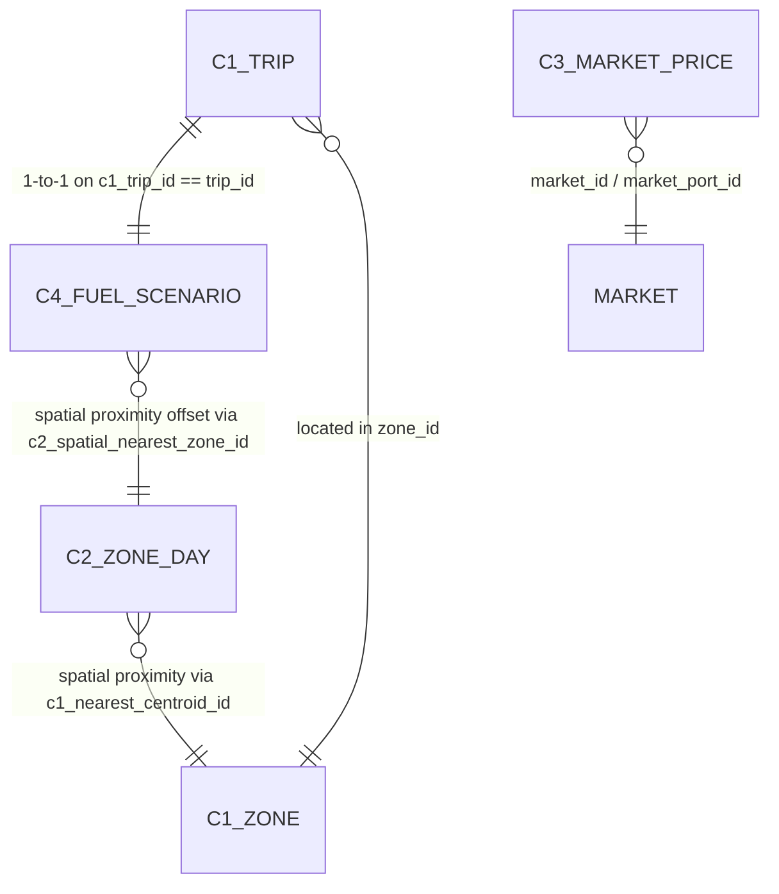

# OceanGuard AI — Cross-Dataset Integration Mapping and Data Contracts

## 1. Primary and Foreign Key Architecture

The four datasets relate through spatial, vessel, and trip identifiers. However, critical temporal and scope boundaries must be respected:

## 2. Temporal and Spatial Disconnect Disclaimers

1. **C1 vs C2 Disconnect:** C1 trips occur in chronological timestamps from 2023 to 2024. C2 zone days occur in 2025. Joining C1 trip rows with C2 zone-days by row index is INVALID. Linkage between C1/C4 and C2 is strictly spatial proximity (`c1_nearest_centroid_id` and `c2_spatial_nearest_zone_id`).
2. **C1 vs C4 Integration:** C4 scenarios directly correspond 1-to-1 with C1 trips via `c1_trip_id == trip_id`. Every C1 trip has a physics fuel scenario generated with matching vessel dimensions and weather variables.
3. **C3 Market Integration:** C3 market records model 5 landing ports/markets (Peliyagoda, Negombo, Galle, Mirissa, Tangalle) and 5 fish species across 2025. In the end-to-end trip workflow, when a trip lands catch in a specific port, C3 provides multi-horizon forecasts and perishable selling recommendations.

## 3. End-to-End Workflow Data Flow Contract

1. **Stage 1 (Planning):** Vessel profile + departure port + planned zone -> **C1 Safety Service** returns Dynamic Risk Index (DRI), risk level, and dominant risk factors.
2. **Stage 2 (Zone Selection):** Date + target species -> **C2 Fishing Recommendation Service** computes ST-GCN Habitat Suitability Index (HSI) across candidate spatial zones.
3. **Stage 3 (Fuel Planning):** Candidate routes (Distance, speed, current, wave) -> **C4 Fuel Predictor** provides Physics-Informed trip fuel requirement and reserve estimate.
4. **Stage 4 (Catch & Market):** Fisherman logs actual catch (species, kg, storage temp, landing port) -> **C3 Market Engine** forecasts multi-horizon market prices and calculates Expected Net Return for Sell Now vs Wait vs Transport.
