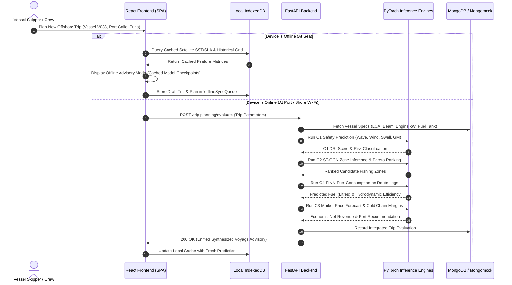

# OceanGuard AI — System Architecture & Design Specification

## 1. Executive Overview

OceanGuard AI is an integrated, offline-first artificial intelligence platform engineered specifically for artisanal, multi-day, and offshore fishing vessels operating within the Exclusive Economic Zone (EEZ) and territorial waters of Sri Lanka. 

The platform tackles four interdependent operational challenges through four specialized deep learning and physics-based models:
1. **Dynamic Vessel Safety & Capsizing Risk Prediction (Component 1):** Bi-LSTM network with Additive Attention predicting Dynamic Risk Index (DRI) and safe operational advisories under extreme maritime conditions.
2. **Spatio-Temporal Fishing Ground Optimization (Component 2):** Spatio-Temporal Graph Convolutional Network (ST-GCN) with non-dominated Pareto multi-objective optimization balancing Habitat Suitability (HSI), navigational distance, and meteorological risk.
3. **Fish Market Price & Cold-Chain Perishability Forecasting (Component 3):** Temporal Fusion Transformer (TFT) combined with Arrhenius/Q10 biological quality decay kinetics for harvest commercialization and transport dispatch.
4. **Physics-Informed Neural Network (PINN) for Marine Fuel Consumption (Component 4):** Neural architecture regularized by ITTC-1957 naval architectural hydrodynamics and Holtrop residuary resistance constraints.

---

## 2. High-Level Architectural Diagram

```
+---------------------------------------------------------------------------------------+
|                                    PRESENTATION TIER                                  |
|  React 18 + TypeScript + Vite + Material UI v5 + Leaflet Interactive GIS Cartography  |
|                                                                                       |
|  [Vessel Ops]  [Trip Planner]  [C1 Safety]  [C2 Fishing]  [C3 Market]  [C4 Fuel PINN] |
+-------------------------------------------+-------------------------------------------+
                                            |
                         REST API (JSON)    |   Offline Fallback & Sync
                                            v
+---------------------------------------------------------------------------------------+
|                               CLIENT-SIDE OFFLINE ENGINE                              |
|   - IndexedDB (idb wrapper): Schema stores (vessels, trips, cachedPredictions, queue) |
|   - ServiceWorker / Axios Interceptor: Transparent background mutation capture        |
|   - Reconnection Re-sync: Automatic queued replay upon shore cellular/Wi-Fi link       |
+-------------------------------------------+-------------------------------------------+
                                            |
                         HTTPS / WebSockets |
                                            v
+---------------------------------------------------------------------------------------+
|                                APPLICATION SERVER (FASTAPI)                           |
|   - App Gateway & CORS Middleware                                                     |
|   - JWT Security & PBKDF2-HMAC-SHA256 Auth (Skipper, Harbour Officer, Researcher)     |
|   - API Routers: /auth, /vessels, /trips, /ml (C1, C2, C3, C4), /rescue, /data        |
+---------------------+---------------------+---------------------+---------------------+
                      |                     |                     |
                      v                     v                     v
+-----------------------------+ +---------------------------+ +-------------------------+
|      INTELLIGENCE LAYER     | |    DATA PERSISTENCE LAYER | |   OBSERVABILITY LAYER   |
| - PyTorch C1 Bi-LSTM Attn   | | - MongoDB Replica Set /   | | - Audit Logging         |
| - PyTorch C2 ST-GCN         | |   Standalone Instance     | | - Health Check Endpoints|
| - Scikit/PyTorch C3 Market  | | - In-memory Mongomock     | | - Model Version Registry|
| - PyTorch C4 PINN Hydro     | |   Zero-Config Fallback    | | - Prediction Telemetry  |
+-----------------------------+ +---------------------------+ +-------------------------+
```

---

## 3. Core Component Interactions & Unified Data Flow



---

## 4. Subsystem Breakdown

### 4.1 Backend Engine (FastAPI)
- **Framework:** FastAPI with asynchronous ASGI execution (`uvicorn`).
- **Data Validation:** Strict Pydantic v2 schemas across all operational inputs and scientific outputs.
- **Security:**
  - Password hashing utilizing cryptographic PBKDF2 HMAC SHA-256 with 100,000 iterations and per-user cryptographic salt.
  - Stateless JSON Web Tokens (JWT) signed with HS-256.
  - Role-Based Access Control (RBAC) enforcing distinct privilege levels:
    - `SKIPPER`: Vessel operations, trip logging, offline syncing, distress beacon broadcast.
    - `OFFICER`: Port clearance, safety validation, fleet overview, rescue coordination.
    - `RESEARCHER`: Raw dataset inspection, ML retraining telemetry, physics validation audits.

### 4.2 Data Persistence & Fail-Soft Resilience
- **Primary Storage:** MongoDB database with indexed collections (`vessels`, `trips`, `users`, `emergency_events`, `observations`, `prediction_history`).
- **Resilience Fallback:** The backend dynamically probes MongoDB availability upon startup. In isolated local environments where no MongoDB daemon is installed or running, the connection manager automatically provisions an in-memory `mongomock` instance with complete collection seeding, ensuring 100% test and runtime reliability.

### 4.3 Client-Side Offline-First Architecture
- **Local Storage Engine:** Native browser IndexedDB orchestrated through `idb`.
- **Cached Schemas:**
  - `vessels`: Fleet specifications and hydrostatic parameters.
  - `trips`: Active voyages and historical catch logs.
  - `cachedPredictions`: Latest spatial fishing zones, safety limits, and market trajectories.
  - `offlineSyncQueue`: Transactional log storing queued mutations (`POST`, `PATCH`) timestamped while offshore.
- **Reconnection Sync:** When browser connectivity transitions to online (`navigator.onLine === true`), the synchronization manager automatically dequeues pending actions, transmits them sequentially to the backend, and reconciles IDs.

---

## 5. Security and Operational Integrity
1. **No External Cloud Dependency:** The system functions completely on-premise or within isolated maritime LANs.
2. **Explicit Scientific Provenance:** Every response payload generated by ML pipelines explicitly includes a `scientific_disclaimer` and flags synthetic or proxy features (`synthetic_proxy_heuristics`).
3. **Distress Protocol Isolation:** Emergency rescue beacons (`/rescue/emergency`) are processed with highest priority, bypassing non-critical data transforms and emitting instant audible alerts to coastal authorities.
